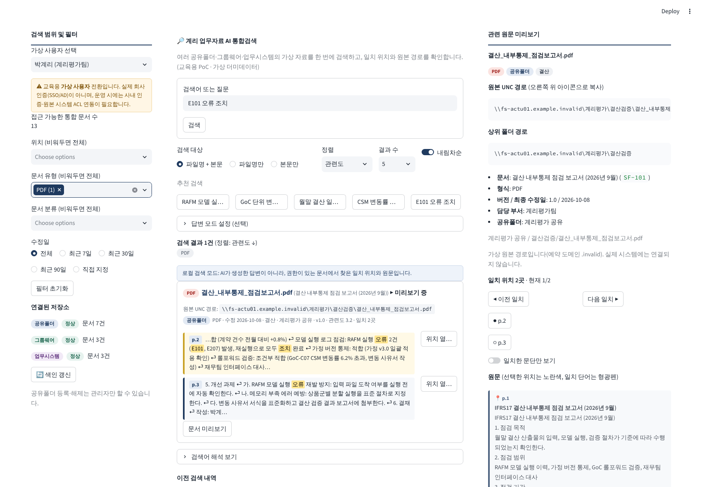

# 계리 업무자료 AI 통합검색 Tool (교육용 PoC)

여러 공유폴더(UNC) · 그룹웨어 · 업무시스템에 흩어진 **가상의** 계리 업무자료(MD/TXT/PDF/Excel/PowerPoint)를 검색하고,
일치한 **원문 위치**(PDF 쪽 · Excel 시트/셀 · PPT 슬라이드 · 텍스트 줄)와 원본 UNC 경로를 한 화면에서 확인하는 Streamlit 웹앱입니다.



> **교육용 PoC 범위**
> - 모든 자료는 `data/` 의 **직접 만든 가상 더미데이터**입니다. 실제 사내 시스템·인터넷·외부 API 에 연결하지 않습니다.
> - 기본 실행은 **로컬 검색 모드**(키워드 + 관련성 점수)입니다. 이 모드의 결과는 *AI 생성 답변이 아닙니다.*
> - **실제 LLM 은 연결되어 있지 않습니다.** AI 답변 모드는 인터페이스와 **Mock(테스트용)** 구현만 제공합니다.
> - 화면의 사용자 전환은 **가상 사용자**이며 실제 회사 인증(SSO/AD)이 아닙니다.

## 폴더 구조

```text
ai-poc-doc-search/   (저장소 루트)
├── app.py                 # Streamlit 3단 화면 (왼쪽: 자료·범위 / 가운데: 검색 / 오른쪽: 근거 문서)
├── conftest.py, pytest.ini
├── requirements.txt, .env.example
├── README.md, README_DEMO.md   # 실행법 / 시연·수동 테스트 시나리오
├── docs/
│   ├── DESIGN.md          # 설계, 점수 규칙, 보안 설계, 사내망 연동 시 추가 필요사항
│   └── TEST_RESULTS.md    # 자동 테스트 결과표 (입력조건 / 예상 / 실제 / 통과)
├── tools/make_sample_files.py  # 샘플 PDF/Excel/PPT 생성기 (개발 전용, requirements-dev.txt 필요)
├── tools/build_web_demo.py     # 정적 웹 시연판(HTML) 생성기 — data/ 에서 tools/web_demo_template.html 로 빌드
├── tools/benchmark_search.py   # 검색 성능 벤치마크(합성 데이터)
├── scripts/run_real.ps1, run_demo.ps1   # 실제 Windows 모드 / 데모 모드 실행
├── ui/setup_page.py            # 실제 모드 초기 설정 화면
├── connectors/            # 저장소별 Connector (공통 인터페이스 base.py)
│   ├── base.py  shared_folder.py  groupware.py  business_system.py
├── core/
│   ├── models.py          # 공통 문서 스키마
│   ├── document_parser.py # 메타데이터 파싱, 문단 분할(줄 번호), 지시문 의심 탐지
│   ├── extractors.py      # PDF(쪽)/Excel(시트·셀)/PPT(슬라이드) 추출 — 표준 라이브러리만 사용
│   ├── shares.py          # 공유폴더(UNC) 등록부
│   ├── fs.py, identity.py, app_config.py, metadata.py, setup_check.py   # 실제 모드: 파일시스템 추상화·Windows 계정·설정·자동 메타데이터·연결 테스트
│   ├── indexer.py         # SQLite 색인 (documents / chunks / source_status)
│   ├── text_utils.py      # 한국어 용어 정규화·동의어 확장
│   ├── search_engine.py   # 점수 산정, 권한 필터, 캐시 재검증
│   ├── access_control.py  # 가상 사용자·문서 ACL (기본 거부)
│   ├── sync_manager.py    # 신규/수정/삭제/버전/권한 변경 감지·색인 갱신
│   ├── answer_generator.py# 모드 A(로컬) / 모드 B(AI, 선택) RAG
│   ├── llm_client.py      # LLM 연결 인터페이스 + Mock (실제 호출 없음)
│   ├── history.py         # 이전 답변 내역 재검증
│   └── services.py, config.py, logging_utils.py, presentation.py
├── data/
│   ├── shared_folder/{계리평가,재무공유,관리}/ groupware/posts/ business_system/records/   # 가상 문서 15건
│   ├── metadata/search_dictionary.json   # 동의어·불용어·별칭 사전
│   ├── metadata/shares.json              # 등록된 공유폴더(UNC ↔ 가상 폴더)
│   └── demo_users.json                   # 가상 사용자 3명
├── database/              # SQLite 색인 파일(index.db)이 자동 생성되는 위치 (git 제외)
└── tests/                 # pytest (자동 테스트 247건, 브라우저 테스트 포함)
```

## Windows PC 실행 방법 (PowerShell)

Python 3.10 이상이 필요합니다. 저장소 루트(`ai-poc-doc-search`)에서 시작합니다.

```powershell
# 1) 저장소 루트로 이동 (이미 루트라면 생략)
cd ai-poc-doc-search

# 2) 가상환경 생성 및 활성화
py -3 -m venv .venv
.venv\Scripts\Activate.ps1
#   (실행 정책 오류 시: Set-ExecutionPolicy -Scope Process -ExecutionPolicy RemoteSigned)

# 3) 패키지 설치 (streamlit, pytest)
python -m pip install -r requirements.txt

# 4) 웹앱 실행 → 브라우저에서 http://127.0.0.1:8501
python -m streamlit run app.py

# 5) 자동 테스트 실행 (다른 터미널, 가상환경 활성화 후)
python -m pytest
#   브라우저(Chromium) 종단 테스트까지 실행하려면 (선택):
#   python -m pip install -r requirements-dev.txt ; python -m playwright install chromium
#   결과표를 파일로 저장하려면:
python -m pytest --report-md docs/TEST_RESULTS.md
```

macOS/Linux 는 `python3 -m venv .venv && source .venv/bin/activate` 후 동일하게 실행합니다.
설치 외에는 인터넷이 필요하지 않습니다. 첫 실행 시 자동으로 색인(`database/index.db`)이 만들어집니다.

## 설정 (선택)

`.env.example` 을 `.env` 로 복사해 수정합니다. 환경변수로도 지정할 수 있습니다.

| 변수 | 기본값 | 설명 |
|---|---|---|
| `LLM_PROVIDER` | `none` | `none`(비활성) / `mock`(테스트용 가짜 LLM) / `internal`(사내 LLM — **미구현**) |
| `SEARCH_TOP_K` | `5` | 결과 문서 수(최대 5) |
| `DATA_DIR`, `INDEX_DB_PATH` | `data/`, `database/index.db` | 데이터·색인 경로 |

## 주요 기능

- **화면 구성**: 왼쪽 `검색 범위 및 필터` / 가운데 `검색 결과` / 오른쪽 `관련 원문 미리보기`
- **검색 결과 행**: 문서명(파일명), 파일 형식 배지, 수정일, **원본 UNC 경로**, 관련도 점수, 일치 위치 수와 위치별 발췌
  - 위치 표기: PDF `p.2` · Excel `시트 '요약' · 셀 A3:E3` · PowerPoint `슬라이드 3` · MD/TXT `줄 14–18` · 게시글/레코드 `§ 소제목`
- **필터·정렬**: 위치(공유폴더별 다중 선택) · 문서 유형 · 분류 · 수정일(최근 7/30/90일, 직접 지정). 값을 바꾸면 검색 버튼 없이 즉시 재검색.
  검색 대상(파일명+본문 / 파일명만 / 본문만), 정렬(관련도·수정일·파일명·형식·경로, 오름/내림), 결과 수(5/10/20)
- **원문 미리보기**: 일치 단어 형광펜, 선택 위치 강조, `이전/다음 일치` 이동, 일치 문단만 보기, UNC 경로·상위 폴더 경로 **복사 버튼**
- **공유폴더 등록(관리자)**: UNC 경로를 가상 폴더에 연결해 여러 공유를 한 번에 검색 (실제 SMB 접속은 구현하지 않음)
- 사용자별 접근권한(가상 사용자 3명): 비인가 문서는 검색·미리보기·AI 근거·건수·필터 선택지·캐시·이전 답변 어디에도 나타나지 않음
- `색인 갱신` 버튼: 신규/수정/삭제/버전/권한 변경 반영 (저장소 한 곳이 실패해도 나머지는 계속 동작, 실패 저장소는 화면에 표시)
- 문서 속 악성 지시문은 **실행하지 않고** 경고 표시 + AI 전달 제외. AI 답변 모드는 Mock 구조 테스트만 제공
- 검색 방식·점수 규칙: [`docs/DESIGN.md`](docs/DESIGN.md) 와 `core/search_engine.py` 상단 주석

## 참고한 검색 도구와 이 프로젝트의 차이

| 참고 도구 | 참고한 아이디어 | 이 프로젝트의 구현 (코드·디자인은 독자 구현) |
|---|---|---|
| DocFetcher | 본문 검색, 일치 단어 강조, 원문 미리보기 | 일치 단어 형광펜 + 일치 문맥 발췌 + 미리보기 `이전/다음 일치` |
| FileLocator Pro | UNC 공유폴더 등록, 다중 경로 검색 | 등록부(`shares.json`) 기반 다중 공유 + 위치 필터 (가상 폴더 연결) |
| Everything | 파일명 검색, 정렬 가능한 간결한 결과 목록 | `파일명만` 검색 대상, 형식/경로/수정일 정렬, 검색 전 문서 목록 |
| Copernic Desktop Search | 문서 유형·위치·수정일 필터 | 유형/위치/분류/수정일 필터 + 선택지별 문서 수(접근 가능 문서 기준) |

## 실제 Windows 공유폴더 검색 모드 (개인 PC)

데모(가상 데이터)와 별도로, **개인 Windows PC 에서 로그인한 계정으로 읽을 수 있는 실제 공유폴더(UNC)** 를 검색하는 모드를 제공한다.
기본은 데모 모드이고, `APP_MODE=real` 일 때만 켜진다: `.\scripts\run_real.ps1`.

- 초기 설정 화면: **보안 모드 선택 → 공유폴더(UNC) 등록 → 연결 테스트 → 색인 생성**
- 권한: Windows 계정의 실제 파일 접근권한(운영 체제 판정) — 결과를 보여주기 직전마다 파일 열기로 재검증
- 색인 수준: **메타데이터 전용(기본, 파일 내용 미열람)** / 본문 검색(보안 승인 기록 필요)
- `.meta.json` 없이 자동 색인, DOCX·CSV·PDF·Excel·PPT, 증분 갱신, 수정·삭제·권한 변경의 안전한 처리
- 자세한 내용·보안 통제·실기 검증 체크리스트: [`docs/WINDOWS_REAL_MODE.md`](docs/WINDOWS_REAL_MODE.md), 설계·결과: [`docs/WINDOWS_SHARE_PLAN.md`](docs/WINDOWS_SHARE_PLAN.md)
- **현재는 합성 Windows 공유(가상 데이터)로만 검증**했으며 실제 회사 PC 연결 테스트는 보안 승인 후 별도로 수행한다.

## 구현 현황 요약

| 구분 | 상태 |
|---|---|
| 웹앱, Connector 3종, 통합 검색, 권한, 동기화, 근거 확인 | 구현 및 자동 테스트 통과 |
| 다중 UNC 공유 등록, PDF/Excel/PPT 위치 추출, 필터·정렬·미리보기·경로 복사 | 구현 및 자동/브라우저 테스트 통과 (실제 SMB 접속은 미구현) |
| AI 답변 모드 | **인터페이스 + Mock 만 구현·테스트.** 실제 LLM 연결 없음 |
| 실제 사내망(SMB/그룹웨어/업무시스템/SSO) 연동, 자동 스케줄러, 스캔 PDF(OCR)·임베디드 폰트 PDF 추출 | **미구현 (후속 과제)** — `docs/DESIGN.md` §8 |
| Windows PC 실제 실행 | **미검증**(개발은 Linux/Python 3.13 에서 수행) |
